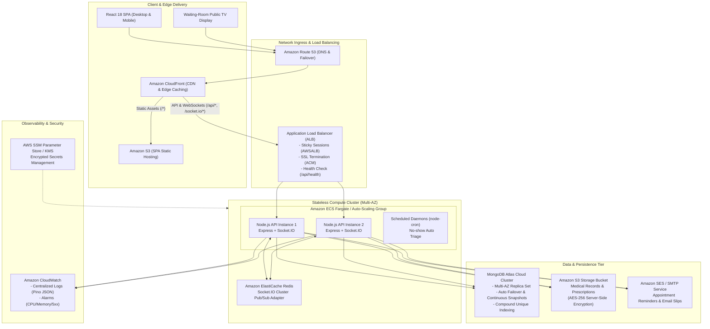
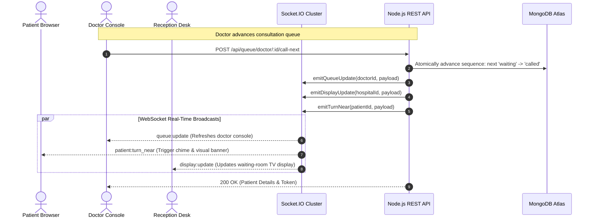

# SmartQueue — Cloud Computing Architecture & System Design

> **Document Purpose:** Engineering Specification & Capstone Report Technical Reference  
> **Target Audience:** Academic Evaluators, Software Architects, and DevOps Engineers  

---

## 1. High-Level Cloud Architecture Diagram

---

## 2. Mapping SmartQueue Features to Cloud Computing Concepts

As a Cloud Computing Capstone Project, SmartQueue's system design directly models core cloud tenets:

| Cloud Computing Concept | Implementation in SmartQueue | Real-World Engineering Benefit |
| :--- | :--- | :--- |
| **1. Stateless Architecture** | Zero session state is maintained in Node.js process memory. Authentication relies on cryptographically signed JWT access tokens with rotating httpOnly refresh cookies. Live websocket connection state is synchronized across instances via Redis Pub/Sub adapter. | Enables horizontal scaling across multiple AWS Availability Zones behind an Application Load Balancer without session synchronization locks. |
| **2. Elasticity & Auto-Scaling** | Containerized backend services deployed to AWS ECS Fargate or EC2 Auto-Scaling Groups with CPU/Memory utilization target-tracking policies (e.g. scale up when average CPU > 70%). | Automatically scales compute instances during morning peak OPD hours (9 AM - 12 PM) and scales down to minimal baseline at night, optimizing operational costs. |
| **3. High Availability (HA)** | MongoDB Atlas replica sets provisioned across 3 availability zones with automated primary election in under 5 seconds. Multi-AZ ALB distributes ingress traffic across independent data centers. | Zero single points of failure. If an entire AWS data center goes offline, traffic is seamlessly routed to surviving nodes without downtime. |
| **4. Concurrency Control & Data Integrity** | Double-booking prevention enforced via atomic operations and compound partial unique indexes at the database engine level: `{ doctorId: 1, date: 1, startTime: 1 }` excluding `cancelled` and `no_show`. | Guarantees race-condition resilience when dozens of concurrent patients or receptionists attempt booking the exact same timeslot during morning traffic bursts. |
| **5. Pay-As-You-Go Cost Model** | Serverless static hosting on Amazon S3 + CloudFront (\$0.00 base cost with per-request billing), AWS ECS Fargate per-second compute billing, and serverless S3 storage driver for patient records. | Healthcare facilities pay exclusively for consumed resources. Small rural clinics operate near zero cost while large hospitals scale seamlessly. |
| **6. Cloud Security & Defense-in-Depth** | Multi-tier security: Helmet security headers, CORS origin allowlist, Express rate-limiting against brute force, bcrypt password hashing with account lockout, zero-trust Zod schema validation, S3 AES-256 encryption at rest, TLS 1.3 in transit. | Prevents NoSQL injection, cross-site scripting (XSS), IDOR unauthorized record disclosures, and credential stuffing attacks. |
| **7. Backup & Disaster Recovery (DR)** | MongoDB Atlas automated continuous cloud backup snapshots with Point-in-Time Recovery (PITR) up to 7 days, cross-region replication capability, and decoupled S3 document storage. | Near-zero RPO (Recovery Point Objective) and sub-15 minute RTO (Recovery Time Objective) in catastrophic failure scenarios. |

---

## 3. Real-Time Event-Driven Subsystem

---

## 4. Storage Service Cloud Abstraction

SmartQueue features a polymorphic storage provider pattern implemented in `server/src/services/storage.service.ts`:

- **Interface:** `IStorageService` defining `uploadFile`, `deleteFile`, and `getFileStream`.
- **Drivers:**
  - `LocalStorageDriver`: Persists file buffers to local container disk `/uploads` with unique hashes for development and local testing.
  - `S3StorageDriver`: Leverages `@aws-sdk/client-s3` (`PutObjectCommand`, `DeleteObjectCommand`, `GetObjectCommand`) to stream patient prescriptions and lab reports directly to Amazon S3 with AES-256 encryption.
- **Dynamic Configuration:** Switchable at runtime via the single environment variable `STORAGE_DRIVER=s3` or `STORAGE_DRIVER=local`.
